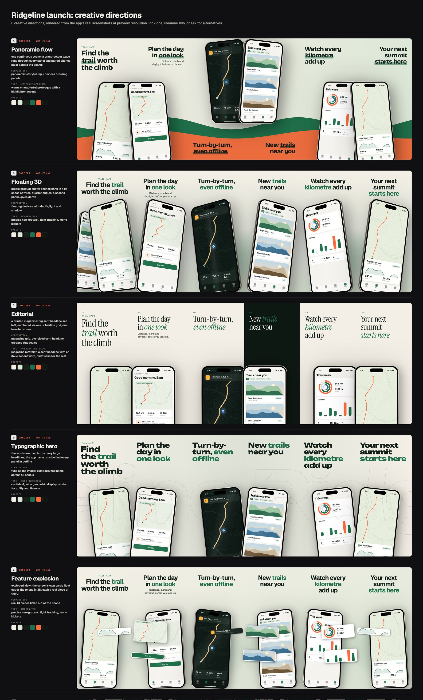

# App Store kit

A skill for Claude Code that takes an iPhone/iPad app from code to the App Store, and keeps it updated.

You say one sentence. It does the rest, step by step, and stops only where Apple needs you.

| You say | What happens |
|---|---|
| "Put my app on the App Store" | Checks your code against Apple's current review rules, writes the product page, makes screenshots, uploads the build, fills App Store Connect, submits, releases |
| "Ship an update" | Drafts What's New from your git history, raises the version, uploads the build, creates the new version and updates every language |
| "Add German and Japanese" | Adapts the store texts per language (not word-for-word), makes localized screenshots, places them |
| "What's the status?" | Reads your App Store Connect account and answers in plain words |
| "Market it" | Custom product pages, A/B tests of the product page, in-app events |
| "Is it working?" | Downloads Apple's analytics and shows which page converts, and what to test next |
| "Apple rejected my app" | Maps each cited guideline to a fix and drafts the reply (you send it) |
| "Answer the reviews" | Reports themes and crashes from reviews, drafts replies, sends only the ones you approve |
| "Add subscriptions", "run a beta", "change the price" | Subscriptions, external TestFlight with feedback triage, prices per country and pre-orders |

## Designed screenshot campaigns

Beyond caption templates, the kit art-directs a screenshot set from the app's **real** screens: continuous panoramas
across panels, 3D phones crossing the seams, editorial type, a dark spread, UI cards lifted out of the phone.

```
Make six premium App Store screenshots for this app.
Make a panoramic six-screen campaign: floating iPhones, editorial type, cinematic light.
Redesign my existing App Store screenshots. Keep the real UI and branding. Show me six different concepts first.
Make English, Hebrew and Russian versions of the chosen campaign.
Use these reference images for the quality bar and art direction; don't copy them.
```

How it works (`scripts/campaign.py`, details in `references/creative-director.md`):

1. **Inputs.** Required: the app's screenshots. Optional: the icon (palette), brand colours and font files,
   reference images (read for technique, never copied), background art with its source and licence.
2. **Concepts.** `campaign.py concepts` renders six different directions as one contact sheet (each a full low-res
   panorama with its rationale, type and palette). You pick one, combine two, or ask for others.
3. **Copy.** One benefit per panel. Numbers, rankings, ratings and awards need a source, or the check fails;
   prices, URLs and Apple badges are refused.
4. **Render.** One master image across all panels (headless Chromium), cut into exact App Store sizes, RGB, with a
   QA report (text across seams, safe areas, legibility at search-result size, contrast, missing glyphs).
   The same file always gives the same bytes.
5. **Localize.** Add a locale and its copy; Hebrew and Arabic mirror the whole scene and start from the right.
6. **Export.** `render --install KIT` puts the panels where the rest of the kit uploads them (after your yes).
   `campaign.py canvas` also makes an editable Claude Design canvas.

Replace screenshots: overwrite the files under `screens:` and render again; layout and copy stay. Add a composition
engine: one decorated function in `scripts/studio/engines.py`. A full example from a made-up hiking app ("Ridgeline",
synthetic screens) is in `examples/sample-campaign/`; its rendered contact sheet and en/he/ru sets are in
`examples/sample-campaign/preview/` on GitHub. To render it yourself:

```bash
python3 examples/sample-campaign/make_screens.py      # makes the synthetic screens (not shipped on npm)
python3 scripts/campaign.py concepts examples/sample-campaign/campaign.yaml
python3 scripts/campaign.py render examples/sample-campaign/campaign.yaml
```



Limits: phones are CSS 3D, not ray-traced; no photographed hands unless you supply the art; fonts download once
from Google Fonts (open licences) or come from your files.

## What it does by itself, and where it stops

- **The App Store Connect API does almost everything:** texts in every language, screenshots and previews, age
  rating, accessibility, review details, build, submit, release, phased release.
- **Chrome does the few screens the API can't reach,** such as App Privacy and creating the app record.
- **You do only what Apple reserves for the account holder:** signing in, agreements, tax, banking, EU trader status.
  The skill opens the exact page, outlines the button and waits for you to say "done". It never presses Agree.
- **Nothing reaches Apple without your yes.** A plan is used once and only for the files and account state it saw. Before changing anything it shows one page of planned changes
  (`connect-plan.md`). Upload, submit and release each ask again.
- **One page shows where you are:** `STATUS.md`, with ✅ done, ✋ your turn, 🛑 needs your yes, ⬜ to do.

It is kept current: the references cite Apple's pages with dates, and every change Apple makes to App Store Connect
that the skill finds on a live run is written back (see `.living/CHANGELOG.md`).

## Install

```bash
npx app-store-kit
```

or `npx skills add allexp1/app-store-kit`, or from a clone: `./install.sh`.

Then restart Claude Code. The scripts need Python 3.10+ (and, for rendering, a Chromium: `npx playwright install
chromium-headless-shell` once):

```bash
python3 -m pip install -r ~/.claude/skills/app-store-kit/requirements.txt
```

## The App Store Connect key (once)

The skill asks before it uses a key, once per session. To make one: App Store Connect › Users and Access ›
Integrations › App Store Connect API › Team Keys › Generate (role **App Manager**), then download the `.p8` file to
`~/.appstoreconnect/private_keys/`. The skill only stores the Key ID and Issuer ID in your kit. It never opens,
prints or commits the key file.

## What's inside

- `SKILL.md`: the instructions Claude follows.
- `scripts/`:
  - `precheck.py`: code against Apple's rules.
  - `asc_api.py` and `asc_sync.py`: the App Store Connect API (`status`, `plan`, `apply`, `submit`, `release`).
  - `status_board.py`: writes `STATUS.md`.
  - `locales.py`, `whats_new.py` and `release.py`: languages, update notes, version bump, archive and upload.
  - `render.py` and `capture.sh`: screenshots.
  - `campaign.py` (+ `studio/`): designed screenshot campaigns: concepts, panoramas, 3D devices, exact exports.
  - `lint_metadata.py`, `validate_kit.py`, `preview_check.py` and `connect_guide.py`: checks and a hand-typing guide.
  - `growth.py` and `asc_reports.py`: growth and marketing, and measuring it.
  - `rejection.py` and `reviews.py`: App Review rejections; ratings and approval-gated review replies.
  - `subscriptions.py`, `testflight.py` and `pricing.py`: subscriptions, TestFlight betas and feedback, prices and
    availability.
- `references/`: Apple's specs, review guidelines, App Store Connect fields, the API, privacy labels and copywriting.
- `tests/`: `./test.sh` runs everything offline, without keys.

## License

MIT
